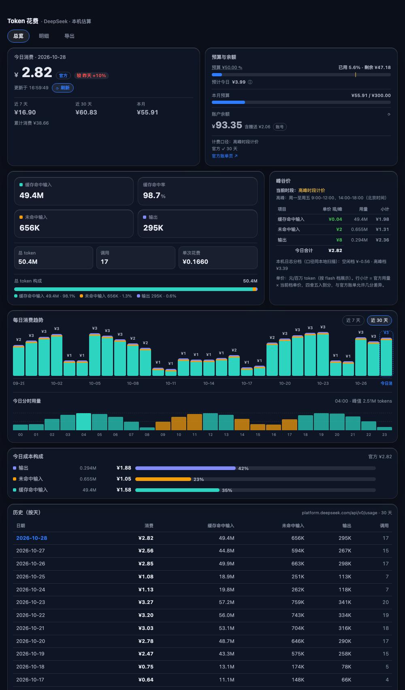
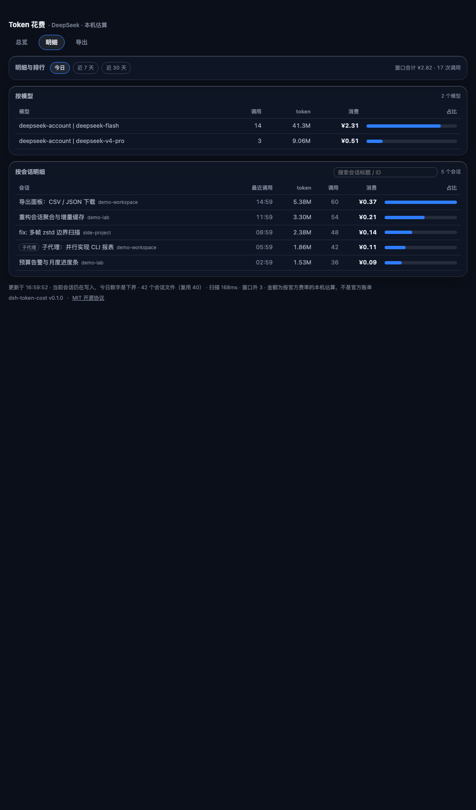
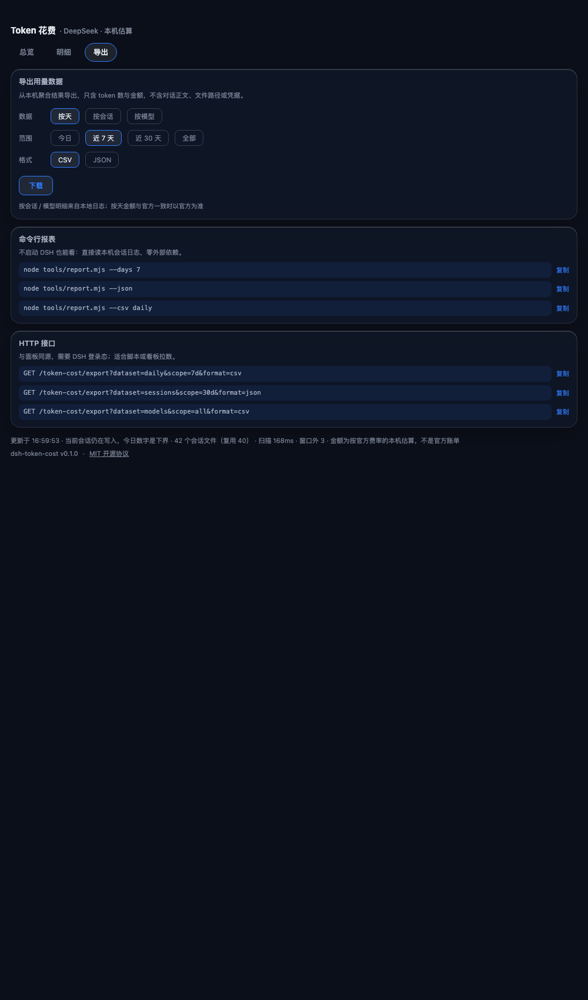

# dsh-token-cost

> A **token spend panel** for DSH (DeepSeek Harness): what you spent today, where it went,
> how much prompt caching saved, and how much budget is left.
> Compatible with DSH 0.2.x, **zero external dependencies** (bundled multi-frame zstd decoder —
> no `zstd` binary or Homebrew required).

[中文](README.md) | English

> This is a community plugin, not an official DeepSeek plugin. Amounts are **local estimates**,
> not an official invoice; refer to the [official pricing page](https://api-docs.deepseek.com/quick_start/pricing).

---

## What it is

Derived from the community plugin [`dsh-token-meter-panel`](https://github.com/olimc2016/dsh-token-meter-panel)
(MIT, 0.6.7), this project keeps its collection / pricing / official-usage core but **rebuilds the
panel UI** and adds daily-cost projection, a monthly budget, per-model breakdown, CSV/JSON export
and a standalone CLI report.

DSH records token usage in session logs but **does not price it**. This plugin turns usage into money:

- **Today / last 7 days / last 30 days / this month** spend, plus account balance
- **Budget progress**: daily budget, monthly budget, and a "projected today" figure
- **Where the money went**: cached input / uncached input / output, with per-model, per-session
  and per-provider rankings
- **What caching saved**: cached-input price is 1/50–1/30 of the uncached price
- **Portable**: one-click CSV / JSON export; `node tools/report.mjs` works without DSH



<table>
<tr>
<td width="50%"></td>
<td width="50%"></td>
</tr>
<tr>
<td align="center"><sub>Breakdown: model / session / provider</sub></td>
<td align="center"><sub>Export: download + CLI + HTTP API</sub></td>
</tr>
</table>

> Screenshots are rendered from **synthetic data** via `node tools/preview.mjs --demo`;
> they contain no real sessions, paths or balances.

---

## Features

| View | Content |
|---|---|
| **Overview** | Today's spend (official vs local badge), vs yesterday, projection, daily / monthly budget, balance, 7/30-day and month totals, four token stats, hit rate, cost per call, cost composition, peak/off-peak prices, 30-day trend, hourly distribution, live session usage |
| **Breakdown** | Today / 7d / 30d switch; per-model spend and share, per-session table (search, subagent tag), per-provider totals |
| **Export** | Daily / sessions / models × today / 7d / 30d / all × CSV / JSON, one-click download; CLI and HTTP examples |

More:

- **Peak / off-peak pricing**: Beijing time Mon–Fri 09:00–12:00 and 14:00–18:00, computed per tier then summed
- **Official cross-check**: optional DeepSeek account session or `platform.deepseek.com` web login
- **Balance**: DSH account or `DEEPSEEK_API_KEY`; the account path also exposes lifetime spend
- **Edit settings in the panel**: click the budget / low-balance hint to write the value back
- **Skins**: `default` (follows DSH theme) / `glass`
- **Zero-config**: no API key and no external decompressor needed

---

## Install

### GitHub (recommended, pinned)

```bash
dsh plugin --profile desktop add github:catgrandfa/dsh-token-cost#v0.1.0
```

Use `--profile web` for the web profile.

### One-liner scripts

**macOS / Linux**

```bash
curl -fsSL https://raw.githubusercontent.com/catgrandfa/dsh-token-cost/main/install.sh | bash
```

**Windows (PowerShell)**

```powershell
powershell -ExecutionPolicy Bypass -Command "iwr -UseBasicParsing https://raw.githubusercontent.com/catgrandfa/dsh-token-cost/main/install.ps1 | iex"
```

### From source

```bash
git clone https://github.com/catgrandfa/dsh-token-cost.git
cd dsh-token-cost
npm install --cache /tmp/dsh-npm-cache
npm run setup
npm test
dsh plugin --profile desktop add .
```

> Fully quit and restart DSH after installing. A "Token" entry appears at the bottom of the sidebar.

**Coexistence**: package name, route prefix (`/token-cost`), settings namespace (`token-cost`) and
sidebar slot id (`tokencost`) are all independent from the upstream plugin, so both can be installed
side by side.

---

## Pricing model

Costs are estimated from **official DeepSeek CNY prices**:

- Models: `deepseek-flash`, `deepseek-v4-pro` (legacy `deepseek-v4-flash` is billed as Flash)
- **Two tiers**, off-peak = half of peak
- Peak: Beijing time Mon–Fri 09:00–12:00 and 14:00–18:00 (public holidays not detected)
- `reasoningTokens` are already part of `outputTokens`
- **Unknown models are never priced**: tokens are counted, money is not guessed
- Price source: <https://api-docs.deepseek.com/quick_start/pricing> (captured 2026-09-19)

All rates, budgets, alert thresholds and refresh intervals are editable under
**Settings → Plugins → token-cost**.

---

## Data sources

1. **Local session logs** (the only source for per-session / per-model detail)
   `$DSH_HOME/sessions/<workspace>/<session>/session[.vN].jsonl[.zstd]`, aggregated by Beijing day.
   Multi-frame zstd is decoded in pure JS (`src/zstd.mjs`).
2. **Official usage** (optional; preferred for daily totals)
   DSH account session when signed in, otherwise the browser `userToken` of `platform.deepseek.com`.
3. **Balance / lifetime spend**: account service or `api.deepseek.com/user/balance`.

### Known gaps

- Session-title generation and web-search calls do not persist `usage`
- Active sessions are still appending, so "today" is a lower bound (noted in the panel footer)
- Local estimates may differ from the official bill by a few cents

---

## Export & CLI

### Panel export

Pick **dataset × scope × format** in the Export view and download. Exports contain token counts,
costs and session metadata only — **no prompts, file paths or credentials**.

HTTP endpoints (same origin, DSH auth):

```bash
GET /token-cost/export?dataset=daily&scope=7d&format=csv
GET /token-cost/export?dataset=sessions&scope=30d&format=json
GET /token-cost/export?dataset=models&scope=all&format=csv
```

### CLI

Works without DSH running (Node built-ins only):

```bash
node tools/report.mjs --days 7 --top 5        # readable: summary + daily + models + sessions
node tools/report.mjs --json
node tools/report.mjs --csv daily             # daily | sessions | models
node tools/report.mjs --budget 5
node tools/report.mjs --sessions-root ~/.dsh/sessions
```

---

## Privacy

- Reads `$DSH_HOME/sessions/**` only; writes no business files; spawns no commands
  (the single exception is the optional background auto-update, which runs `dsh plugin add`
  only after 60 s uptime when a new release is found, and can be disabled)
- Credentials are resolved by **reference name** through DSH and stay in the host process
- Browser-session reading copies `Local Storage/leveldb` to a temp dir, extracts only the
  `platform.deepseek.com` entry, then deletes the copy
- Network is limited to official usage / balance (optional) and the GitHub release check (optional)

---

## Compatibility

- DSH 0.2.x (tested on 0.2.0-rc.2); Node ≥ 22.19
- macOS tested; Windows / Linux covered by CI
- No npm release yet; install via GitHub

---

## Development

```bash
npm install --cache /tmp/dsh-npm-cache
npm run setup
npm run build          # rebuild lib/client.js after editing src/client/**
npm test               # verify-* / smoke-* / report
node tools/preview.mjs --demo --view overview   # synthetic preview (no real logs)
```

---

## License

MIT — see [LICENSE](LICENSE). Derived from
[`dsh-token-meter-panel`](https://github.com/olimc2016/dsh-token-meter-panel)
(MIT, `Copyright (c) 2026 oli20`); `src/zstd.mjs` adapts DSH's
`@deepseek-ai/dsh-session-persistence-jsonl` (MIT, `Copyright (c) 2026 DeepSeek`).
See [THIRD-PARTY-NOTICES.md](THIRD-PARTY-NOTICES.md).

## Credits

- [oli20](https://github.com/olimc2016) for the upstream collection core, pricing model and
  official-usage plumbing
- The DeepSeek Harness team for the plugin system and session-log format
